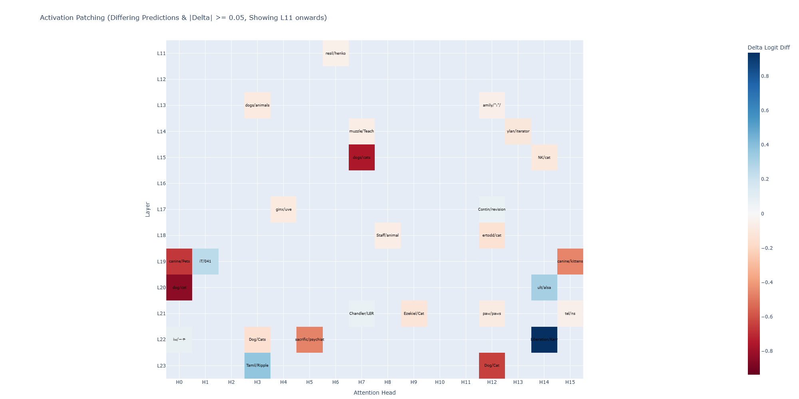
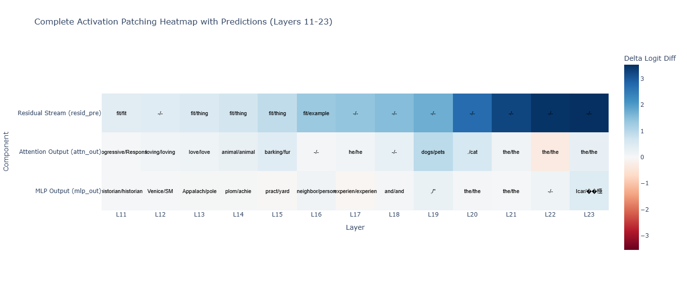

# How the representation of the token evolve at different time steps? 

[!How to use and interpret Activation Patching](https://arxiv.org/pdf/2404.15255)

Hardly Thanks to Neel Nanda's work on Activation Patching, which really helped to investigate the phenomenon in details. Although there are certain more research exploration is about to happen because the techniques such as Ablating the certain activations to see the impact of hidden layers is very crucial to expose. I would highly recommend to explore the paper and try to spend the time on it. 

If you want to explore and read the experiment techniques, please consider the below repo, where I completely explain and show the results.

[Activation Patching GPT-2](https://github.com/fahdev789/activation-patching-gpt2)

<p align="center">
  
</p>

A hands-on exploration of **Mechanistic Interpretability (Mech. Interp.)** using [TransformerLens](https://github.com/TransformerLensOrg/TransformerLens). This project investigates how information flows through GPT-2. The important thing the model starts considering the token from Layer 11, which specifically helps that the earlier layers L0-L10 are not really participating in the model's prediction. Sorry this is the finished experiment output because the aim is to give you a very specific high focus overview of the model behavior. Rather than spending weeks to study the code through this you can easily develop the concepts. 

During the exploration, you will see three words will occur as baseline which tries to pull the model attention `is a good`. When the prompt transitions from "dog" to "cat", the semantic context shifts, sometimes causing unpredictable logit fluctuations in the underlying vocabulary space.
## 🔍 Project Overview

This repository explores three complementary techniques:

- **Activation Patching:** Intervene on internal activations to investigate which components causally influence a model's output.
- **Logit Lens:** Project intermediate residual stream representations into vocabulary space to examine how token predictions evolve across layers.
- **Direct Logit Attribution (DLA):** Measure how individual attention heads and other components contribute to a target token's logit.

The experiments use clean and corrupted prompts to investigate how GPT-2 represents semantic information and how attention and MLP components contribute to the final prediction.

<p align="center">
  
</p>

## 🧪 Experimental Setup

The experiments use a simple prompt-corruption setup to investigate how changing a single word affects the model's internal representations.

**Clean prompt**

```text
My dog is a good
```

**Corrupted prompt**

```text
My cat is a good
```

The objective is to understand how replacing `dog` with `catcher` affects the residual stream, intermediate token predictions, and downstream model behavior.

Activation patching allows activations from the clean run to be substituted into the corrupted run at selected layers or components. The resulting change in the target metric helps identify which internal pathways are most responsible for the final output.

---


## 🔬 Core Insights

### 1. Logit Baseline Shifts and LayerNorm

One counterintuitive observation is that the correct token can receive a **higher** raw logit under a corrupted prompt than under the clean prompt.

For example, the token `' dog'` was observed to receive the following logits:

| Run | Logit for `' dog'` |
|-----|--------------------|
| Clean | 13.741 |
| Corrupted | 13.792 |

Although the prompt changes from `"My dog is a good"` to `"My cat is a good"`, the raw logit for `' dog'` increases slightly.

This illustrates why raw logits should not be interpreted as direct measurements of semantic correctness or causal importance.

**Potential factors include:**

- **Residual stream representations:** The clean and corrupted prompts produce different combinations of semantic and syntactic features.
- **Layer normalization:** GPT-2 applies final layer normalization before the unembedding operation, changing the scale and distribution of the representation.
- **Shared contextual features:** Both `' dog'` and `' cat'` may align with features associated with the continuation pattern *"is a good [noun]"*.


## 📚 References

- [TransformerLens — Mechanistic Interpretability Library](https://github.com/TransformerLensOrg/TransformerLens)
- [TransformerLens Documentation](https://transformerlensorg.github.io/TransformerLens/)
- [Neel Nanda's Mechanistic Interpretability Resources](https://www.neelnanda.io/mechanistic-interpretability)


## Questions

- If you have any questions, I would love to have a chat. You can send me the email. Thanks for your time to see the repo.
- a first name 8990 at gmail dot com
---
## 📝 License

This project is licensed under the **MIT License**. See the [LICENSE](LICENSE) file for details.
